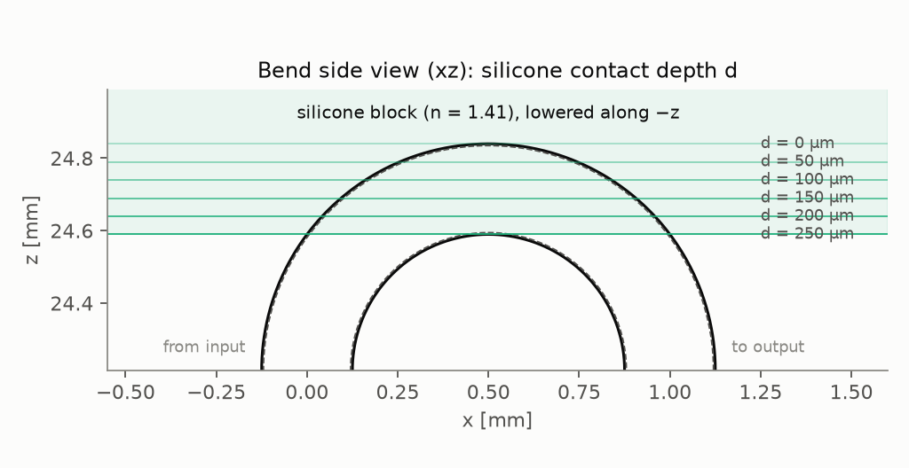
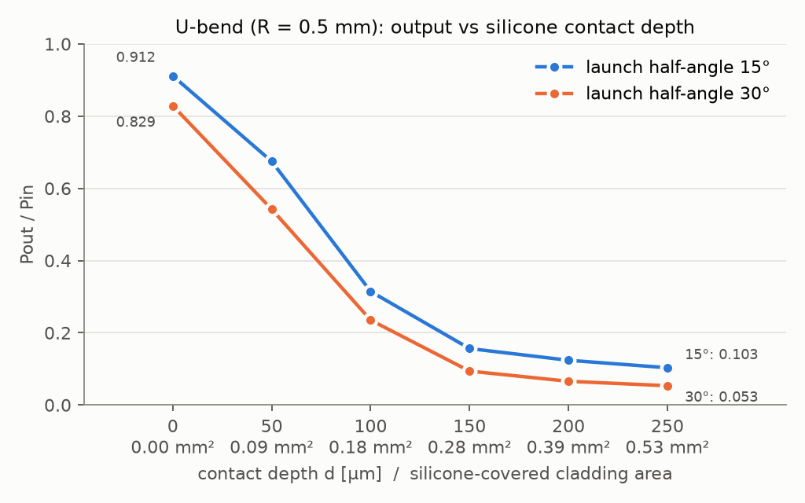

# 실리콘 접촉 깊이에 따른 U-bend 출력 변화 (Mitsuba 3)

2026-10-06 · `contact_sweep.py` / `contact_sweep_plot.py`

## 조건

| 항목 | 값 |
|---|---|
| 광섬유 | core / cladding 지름 240 / 250 µm, n = 1.492 / 1.402, 길이 50 mm |
| 형상 | U자, 180° bend, 중심선 반지름 R = 0.5 mm |
| 광원 | 입력면 1 µm 안쪽 축 위 점광원, core 내부 반각 15° 및 30° (입체각 균일) |
| 주변 | 공기 n = 1.000277 |
| 실리콘 | n = 1.41, 3 × 3 × 1 mm 직육면체 블록, 투명(흡수 없음) |
| 접촉 방식 | bend 바깥면 꼭대기(z = L1 + R + 125 µm) 위에서 −z 방향으로 깊이 d만큼 겹침. d = 0, 50, 100, 150, 200, 250 µm |
| 측정 | Pout/Pin = 출력 끝면(core + cladding)에서 공기로 나간 파워 / 입력 파워 |
| 광선 수 | 조건당 10⁶개 (통계오차 약 ±0.0005) |



### 모델링 가정
- **광섬유는 변형되지 않음.** 실리콘이 겹친 부분을 빈틈없이 감싼다고 봄(완전한 광학 접촉, 공기층 없음).
- 겹친 구간의 cladding 바깥면은 cladding↔실리콘 경계로 바뀜. 판정은 삼각형 중심이 블록 바닥면보다 위에 있는지로 함.
- 실리콘 블록의 공기 쪽 면(윗면, 옆면, 광섬유 단면 모양으로 정확히 구멍을 낸 바닥면)도 실리콘↔공기 경계로 추적함. 실리콘으로 들어간 빛이 다시 광섬유로 돌아오는 경우까지 포함됨.

## 결과



| 깊이 d [µm] | 실리콘 접촉 면적 [mm²] | Pout/Pin (15°) | Pout/Pin (30°) | 출력 중 cladding 비율 (15°) | d = 0 대비 상대 출력 (15°) |
|---:|---:|---:|---:|---:|---:|
| 0 | 0.000 | **0.912** | **0.829** | 0.043 | 100 % |
| 50 | 0.090 | 0.675 | 0.542 | 0.028 | 74 % |
| 100 | 0.184 | 0.314 | 0.235 | 0.009 | 34 % |
| 150 | 0.284 | 0.156 | 0.094 | 0.003 | 17 % |
| 200 | 0.395 | 0.124 | 0.066 | 0.002 | 14 % |
| 250 | 0.533 | 0.103 | 0.053 | 0.002 | 11 % |

- "출력 중 cladding 비율"은 출력면 cladding 영역(r > 120 µm)에 도달한 파워를 입력 대비로 나타낸 값이다.
- 원자료(출력면 도달률, core/cladding 분리, 손실 위치 등)는 `results.csv`에 있다.

**검증:**
- d = 0 결과는 실리콘 블록이 없을 때와 같다 (15°: 0.9116 대 0.9115, 30°: 0.8288 대 0.8288).
- d = 100 µm에서 메쉬를 두 배로 촘촘하게 하거나 시드를 바꿔도 0.314~0.315로 같다.
- 실리콘 안에 갇혀 반사 횟수 한도에 걸린 광선은 10⁻⁴ 미만이다.

## 해석

1. **접촉 초반에 출력이 급격히 떨어진다.** 15° 기준 d = 0 → 100 µm에서 0.91 → 0.31로, 1 µm당 약 0.6%p씩 줄어든다.
   - 실리콘(1.41)의 굴절률이 cladding(1.402)보다 높아서, 접촉 부위의 cladding 바깥면에서는 전반사가 일어나지 않는다.
   - R = 0.5 mm bend에서는 core만으로 빛을 가둘 수 없고, 빛 대부분이 cladding↔공기 경계의 전반사로 bend를 통과한다. 이 경계를 실리콘이 덮으면 그 빛이 실리콘으로 빠져나간다.
2. **d ≥ 150 µm에서는 감소가 느려진다.** 손실이 주로 일어나는 bend 꼭대기 부근이 이미 덮여 있어서, 더 누르면 접촉 면적은 늘어도 추가로 빠질 빛이 적다. 15°에서 0.10~0.16에 머무는데, 이는 "cladding 바깥면의 전반사가 전혀 없을 때" 극한값(이전 계산 0.077)에 가깝다.
3. **출력에서 cladding 쪽 비율이 거의 0이 된다** (0.043 → 0.002). cladding을 따라가던 빛이 접촉 부위에서 먼저 제거된다는 뜻이다.
4. **발사 각도가 크면** 처음부터 손실이 크고 같은 깊이에서도 출력이 더 낮다. 반면 깊이 변화에 따른 상대 감소 경향은 비슷하다.

## 한계와 다음 확인 사항

- **변형 무시:** 실제로 실리콘에 250 µm 직경의 광섬유를 깊게 누르면 광섬유와 실리콘이 모두 변형된다. 정량 예측에는 COMSOL 접촉 해석으로 얻은 변형 형상과 실제 접촉 면적이 필요하다. 이 파이프라인은 원래 그 용도로 설계되었다.
- **기준선(d = 0)의 이상화:** cladding↔공기 경계를 완벽한 매끈한 면으로 가정했기 때문에, 0.91은 실물보다 높을 가능성이 크다(표면 거칠기, 오염, 소성 변형 무시).
- **굴절률 민감도:** n_실리콘 1.41과 n_cladding 1.402의 차이가 아주 작다. 실리콘 굴절률이 cladding보다 낮으면 얕은 각도의 빛은 전반사로 남기 때문에 결과가 크게 달라질 수 있다. 실제 실리콘의 630 nm 굴절률을 확인하고 1.38~1.43 범위로 민감도를 볼 필요가 있다.
- **완전 접촉 가정:** 접촉면에 미세한 공기층이 있으면 FTIR(전반사 깨짐)이 일부만 일어나 손실이 줄어든다. 기하광학 모델에서는 표현되지 않는다.
- **손실 위치 분리:** `results.csv`의 `lost_via_silicone`은 마지막 탈출 지점이 블록 표면인 광선이다. d = 0에서도 0.029가 나오는 이유는, bend에서 공기로 새어 나간 빛이 위의 블록에 들어갔다가 나가는 경우까지 포함되기 때문이다.

## 재현

```bash
conda activate mitsuba
cd ~/hajoon/mitsuba/comsol_mitsuba_fiber_prototype
python contact_sweep.py --config test_bent_fiber/config.yaml \
    --depths 0 0.05 0.10 0.15 0.20 0.25 --thetas 15 30      # 약 35초
python contact_sweep_plot.py
python view_rays.py --config contact_sweep/depth_100um/config.yaml   # 3D로 보기
```
